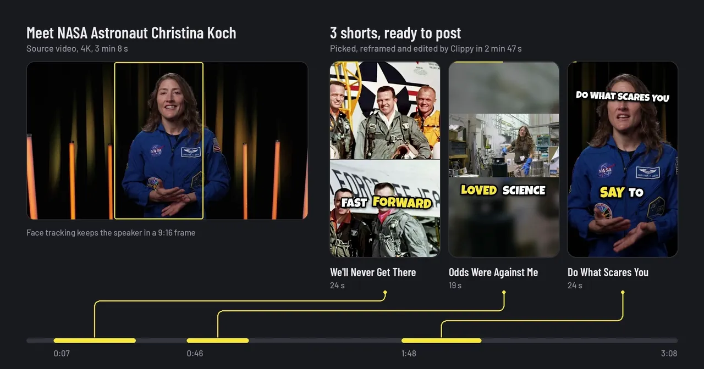
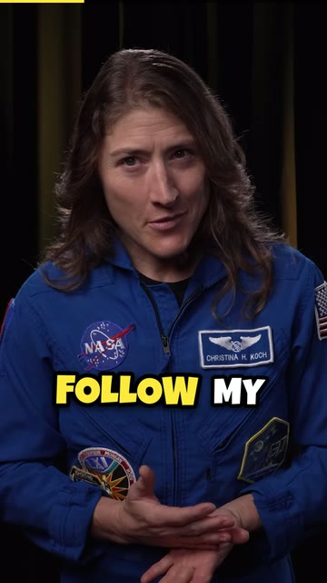
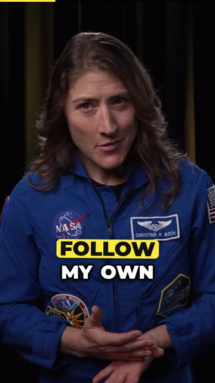
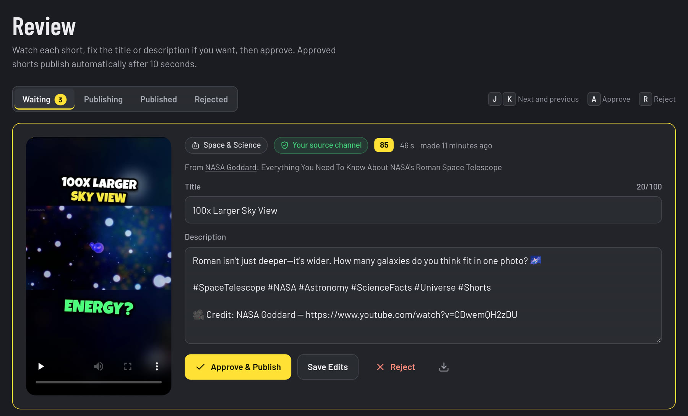

<div align="center">


# Clippy

Turn long videos into ready-to-post vertical shorts, on your own PC.<br>
Local AI picks the moments, then Clippy reframes, captions and edits them. No subscriptions, no API bills.

[](https://github.com/StormAmdam/clippy/actions/workflows/tests.yml)
[](LICENSE)
[](#requirements)

</div>



<sub>Real output, nothing edited by hand. A public-domain NASA interview went in; Clippy picked the three moments
marked on the timeline and turned them into the shorts on the right in 2 min 47 s on an RTX 3080.
The only settings changed: 3 clips, 15–40 s each.</sub>

## What you get

Paste a YouTube link (or drop in a video file) and Clippy:

1. **finds the moments worth posting.** Whisper transcribes the video, then a local LLM reads the whole thing,
   picks the strongest stories and tightens each clip so it opens on a hook and ends on the payoff.
   YouTube's "Most replayed" graph is used when the video has one.
2. **reframes them to 9:16.** Face tracking keeps the speaker in frame and only moves the camera when they do.
   Two people get a split screen; slides and wide shots get a blurred background.
3. **edits for retention.** Dead air is cut, the clip opens with a flash-forward of its best line, captions pop in
   word by word with key words coloured, emojis land on the right words, and whooshes and zoom punches mark the beats.
4. **hands you a finished file** (1080×1920, −14 LUFS, H.264) with a title, caption and hashtags.

Music, gameplay and sports videos work too. Without speech, Clippy picks moments from the sound, the replay graph
and the picture instead.

## Install

### Windows

1. Download **Clippy-Setup-win64.exe** from the [latest release](https://github.com/StormAmdam/clippy/releases/latest)
   and run it. No admin rights needed. (Prefer no installer? The portable zip works from any folder.)
   Windows may say **"Windows protected your PC"** because the installer isn't code-signed yet: click
   **More info**, then **Run anyway**.
2. Clippy opens in its own window. On **AI & Tools**, press **Set Up Everything**: it downloads the video tools,
   the speech model and an AI model that fits your PC, or uses Ollama or LM Studio if you already run one.
3. Paste a YouTube link and press **Make Clips**.

Everything Clippy downloads stays inside its own folder, so uninstalling removes all of it. The uninstaller
offers to move your finished shorts to `Videos\Clippy` first.

### Linux

```
curl -fsSL https://raw.githubusercontent.com/StormAmdam/clippy/main/install.sh | bash
```

Setup puts Clippy in `~/clippy` and walks you through the rest (Python packages, ffmpeg, an emoji font, and a
local AI that fits your PC). Then start it with `clippy app` for its own window, or `clippy web` for a browser tab.
Run the install line again any time to update.

<details>
<summary><b>Windows with WSL instead</b></summary>

The Linux version also runs inside Ubuntu on Windows:

1. Right-click **Start**, open **Terminal (Admin)**, and run `wsl --install`. Restart when it asks.
2. Ubuntu opens after the restart. Choose a username and password.
3. With an NVIDIA card, keep its normal Windows driver up to date; don't install one inside Ubuntu.
4. In Ubuntu, paste the Linux install line. `clippy web` then opens in your Windows browser.
</details>

## Choose your AI

The **AI & Tools** page is where you control the AI. Download any of these and switch between them whenever you
like; the one that fits your PC best is marked. You can also paste a link to any `.gguf` model on Hugging Face.

| Model | Size | Good for |
|---|---|---|
| Qwen3.6 35B-A3B | 17.7 GB | Best picks. Runs partly from RAM, so it needs about 24 GB of RAM |
| Qwen3.5 9B | 5.7 GB | Good picks with an 8 GB graphics card or 16 GB of RAM |
| Qwen3.5 4B | 2.7 GB | Any PC, even without a graphics card |

Clippy runs the model itself: it starts it when it's time to pick clips, pauses it while Whisper needs the
graphics card, and frees the memory after 10 minutes without use. Prefer an AI app you already have? Choose
**Another App** and Clippy uses Ollama, LM Studio, llama.cpp, Jan, KoboldCpp or vLLM (see below).

## Caption styles

The same moment of the same short in each style:

<table>
<tr>
<td align="center"><br><b>Beast</b><br><sub>comic, bouncy, tilted</sub></td>
<td align="center"><br><b>Hormozi</b><br><sub>bold, coloured key words</sub></td>
<td align="center"><br><b>Box</b><br><sub>highlight box</sub></td>
<td align="center"><br><b>Clean</b><br><sub>calm and minimal</sub></td>
</tr>
</table>

Colours, size, position and words per line are all adjustable.

## The app

**Review.** Watch each short, fix the title or description, then approve or reject. Nothing is published without you.



**Find videos.** Ranks YouTube videos by growth, engagement, length and replay peaks. No API key needed.


**Autopilot.** Give it a channel and its sources; it finds a good video, makes the shorts and queues them for you.


Approved shorts upload to YouTube (optionally spaced out, e.g. one every 4 hours) or are exported with a caption
file for posting to TikTok from your phone.

## Requirements

- **Linux** (Ubuntu, Debian, Arch, Fedora…) or **Windows 10/11 with WSL**. Python 3.11+ is all you need beforehand;
  setup installs the rest.
- **An NVIDIA graphics card** is recommended, for fast transcribing and encoding. Everything also runs on the
  CPU, just slower.
- **Disk space:** about 3 GB for Clippy, plus 3–23 GB for a local AI model, plus your videos.

Already cloned the repo? `bash setup.sh` does the same as the install line. It's safe to run again any time, for
example to update yt-dlp when YouTube changes something, or to add an AI later: `bash setup.sh --ai ollama`.

## Use an AI app you already have

Clippy needs a local AI model to read the transcript and pick the moments. **It finds one by itself:** whatever
is running on this PC (or, from WSL, on the Windows side) on these apps' usual ports.

| App | Usual address | Notes |
|---|---|---|
| [Ollama](https://ollama.com) | `127.0.0.1:11434` | Easiest. Clippy asks it for a 16k-token context, so long videos aren't cut off |
| [LM Studio](https://lmstudio.ai) | `127.0.0.1:1234` | Start the server in the Developer tab; load the model with a context of 16384 or more |
| [llama.cpp](https://github.com/ggml-org/llama.cpp) | `127.0.0.1:8080` | Fastest with big models. [`tools/ai-server/`](tools/ai-server/README.md) has a ready launcher |
| [Jan](https://jan.ai), [KoboldCpp](https://github.com/LostRuins/koboldcpp), [vLLM](https://github.com/vllm-project/vllm) | `:1337`, `:5001`, `:8000` | Turn on the app's local API server |
| Anything else OpenAI-compatible | your address | Enter it under **Settings → AI**, with an API key for cloud services |

**Which model:** Clippy uses the model already loaded, otherwise your newest download, and skips embedding models.
Pick another one under **Settings → AI**, which lists every server and model it found. In the terminal,
`clippy ai` shows the same, and `clippy ai test` sends a real request and times it.

**Short on context?** If a server's context window is small, Clippy reads the video in smaller pieces, and splits
any piece the server refuses. Bigger windows (16k or more) are faster and pick better.

**Which model fits your PC:** bigger models pick better clips. Setup picks one for you; these are its choices.

| Your PC | Ollama | llama.cpp |
|---|---|---|
| 22 GB+ graphics memory | `qwen3.6:35b-a3b` | Qwen3.6-35B-A3B, 17.7 GB |
| 7–21 GB graphics memory | `qwen3.5:9b` | Qwen3.6-35B-A3B with 24 GB+ RAM (it runs partly from RAM), otherwise Qwen3.5-9B |
| Less than 7 GB, or no GPU | `qwen3.5:4b` | Qwen3.5-4B (Qwen3.5-9B with 12 GB+ RAM) |

Models that "think" are told not to, which is faster; turn on *Let the AI think first* in Settings to allow it.

<details>
<summary><b>Using an AI that runs on Windows (from WSL)</b></summary>

Clippy looks for the AI on the Windows side too, but Windows apps only listen to Windows itself by default.
Make yours reachable in one of these ways, then run `clippy ai` to check:

- **Ollama for Windows:** add the environment variable `OLLAMA_HOST` = `0.0.0.0` (Start → "Edit environment
  variables for your account"), then quit Ollama from the tray and start it again.
- **LM Studio:** Developer → Settings → turn on **Serve on Local Network**.
- **Any app:** turn on WSL's mirrored networking. Create `%UserProfile%\.wslconfig` containing
  `[wsl2]` and `networkingMode=mirrored` on two lines, then run `wsl --shutdown` in PowerShell. Windows apps are
  then on `127.0.0.1` inside Ubuntu.

Windows Firewall may ask once whether to allow the connection. Running the AI inside Ubuntu instead (the Ollama or
llama.cpp option in setup) avoids all this and uses the same graphics card.
</details>

<details>
<summary><b>Command line</b></summary>

```
./clippy.sh web                      # the web app (add --host 0.0.0.0 to open it from your phone on the same Wi-Fi)
./clippy.sh "https://youtu.be/…"     # or straight from the terminal
./clippy.sh "https://youtu.be/…" -n 8 --max 45
./clippy.sh "https://youtu.be/…" --reuse --style box --color "#3DFF7A"   # same picks, new look (skips the AI)
./clippy.sh "https://youtu.be/…" --no-sfx --no-teaser                    # calmer edit
./clippy.sh "https://youtu.be/…" --no-talking                            # music / gameplay / sport: skip Whisper
./clippy.sh ~/Videos/my-video.mp4    # local files work too
./clippy.sh auto all                 # run every Autopilot channel now (results go to Review)
./clippy.sh ai                       # which AI servers and models Clippy can see, and which it will use
./clippy.sh ai test                  # send the AI a real request and time it
```

After setup, `clippy` works as a shortcut for `./clippy.sh` from any folder.

Clips land in `output/<video-id>/clips/`, with `result.json` holding titles, captions and hashtags.
Re-running a video reuses its download and transcript.
</details>

<details>
<summary><b>Settings</b></summary>

Everything is optional and documented in [`config.toml`](config.toml): AI server, number and length of clips,
caption style, colours and size, hook title, split screen, silence cutting, sound effects, loudness and more.
The **Settings** page in the app covers the common ones, plus storage cleanup and *Start at login*.
Environment variables `CLIPPY_<NAME>` override both, e.g. `CLIPPY_OUTPUT_DIR=/data/clips`.

**Sharing the GPU with the AI:** Whisper needs about 2.6 GB of free graphics memory. If the AI leaves less, Clippy
pauses its systemd service (`llama_service`, default `llama-coder`) or asks Ollama to unload its model while
transcribing; the AI comes back by itself right after. Set `free_gpu_for_whisper = false` to never touch it.
</details>

<details>
<summary><b>How Autopilot picks videos</b></summary>

1. Create a channel in **Autopilot**: niches, keywords, source channels, language, caption look, shorts per run,
   schedule, and where to publish.
2. Press **Run now**, let it run on its schedule while the app is open, or call `./clippy.sh auto all` from cron.
   It scans YouTube, picks the best video it hasn't used yet and makes the shorts.
3. Review them. Approved shorts upload to YouTube or export for TikTok.

By default a channel only clips videos from the **source channels you list** (creators who allow clipping, or
clipping campaigns) and **Creative Commons** videos, and every description gets a credit line. "Creative Commons"
is what the uploader declares; re-uploaders sometimes mislabel.

YouTube uploading takes a one-time, free setup (guided in the app). Google allows about 6 uploads a day on the free
quota, and uploads from an unverified Google Cloud project stay private until it passes Google's free API audit.
TikTok direct posting needs an approved TikTok developer app, so Clippy exports ready-to-post files instead.
</details>

<details>
<summary><b>How Find videos ranks</b></summary>

| Signal | What it measures |
|---|---|
| Views per day | how fast the video is growing right now |
| Breakout | views divided by channel subscribers; outliers point to a topic that's spreading |
| Engagement | (likes + 4 × comments) divided by views |
| Length | long videos (podcasts, interviews, streams) hold the most clippable moments |
| Replay peaks | spikes in YouTube's "Most replayed" graph |
| Licence | Creative Commons means reuse is allowed |

Filter by niche, keywords, a channel watchlist, upload date, length and language, then press **Clip it** on any row.
Each scan is saved in `output/_finder/` so you can compare over time.
</details>

## Development

```
.venv/bin/python -m pytest -q        # no GPU, network or AI server needed
```

FastAPI server (`clippy/server.py`) with a vanilla-JS front end (`clippy/static/`). Each step is its own module:
`download → transcribe → picker / highlights → reframe → overlay → render`.
To move an install with all its data to another PC, see [MOVING.md](MOVING.md).

## Copyright

Platforms don't pay for reposted content you don't have the rights to, and it gets claimed. Clip your own videos,
creators who've given permission, paid clipping campaigns, or properly licensed material, and credit the source.

## License

[MIT](LICENSE) © 2026 Storm Amdam. You're free to use, change and share Clippy, as long as you keep the
copyright notice and credit the original project.

## Credits

- Demo footage: [*Meet NASA Astronaut Christina Koch*](https://www.youtube.com/watch?v=942n6DsJIRw) (NASA Johnson)
  and NASA Goddard videos in the screenshots. NASA material is public domain; NASA does not endorse this project.
- Fonts: [Montserrat](https://github.com/JulietaUla/Montserrat) and [Barlow](https://github.com/jpt/barlow)
  (SIL Open Font License 1.1), [Luckiest Guy](https://fonts.google.com/specimen/Luckiest+Guy) (Apache 2.0).
  Face detection: [YuNet](https://github.com/opencv/opencv_zoo/tree/main/models/face_detection_yunet) (MIT).
  License texts are in [`LICENSES/`](LICENSES).
- Built on [faster-whisper](https://github.com/SYSTRAN/faster-whisper), [yt-dlp](https://github.com/yt-dlp/yt-dlp),
  [FFmpeg](https://ffmpeg.org), [OpenCV](https://opencv.org), [FastAPI](https://fastapi.tiangolo.com) and
  [llama.cpp](https://github.com/ggml-org/llama.cpp).
