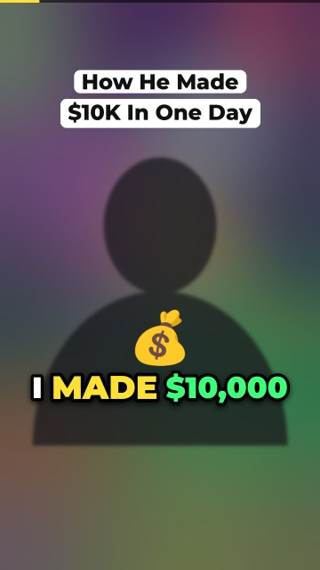
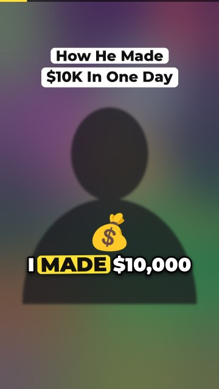
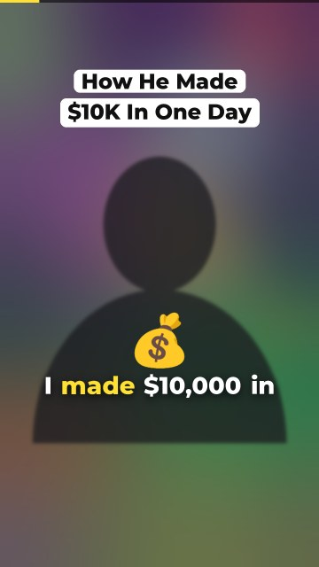

# Clippy

Paste a YouTube link → get ready-to-post vertical clips for TikTok, YouTube Shorts and Reels.
Runs entirely on your own PC with free, local AI: no subscriptions, no API bills.

<table>
<tr>
<td></td>
<td></td>
<td></td>
<td></td>
</tr>
<tr align="center"><td>beast</td><td>hormozi</td><td>box</td><td>clean</td></tr>
</table>

Clippy watches the whole video, picks the moments most likely to hold attention, reframes them to 9:16
around the speaker, cuts dead air and adds retention-style editing: a flash-forward hook, animated
word-by-word captions, emojis, zoom punches and whoosh/pop sound effects. Each clip comes with a title,
caption and hashtags. Autopilot can find videos, make shorts on a schedule and upload the ones you approve.

## Requirements

- **Linux** (Debian/Ubuntu, Arch, Fedora…). On Windows, use WSL2 with Ubuntu.
- **Python ≥ 3.11** and **ffmpeg** (`setup.sh` offers to install ffmpeg if it's missing).
- **An NVIDIA GPU** is recommended (Whisper + NVENC encoding). Everything also runs on the CPU, just slower.
- **A local AI server** for picking clips: any OpenAI-compatible server. See [AI server](#ai-server).
- Optional: an emoji font for caption emojis (`fonts-noto-color-emoji` on Debian/Ubuntu, `noto-fonts-emoji` on Arch).

## Install

```
git clone https://github.com/StormAmdam/clippy.git
cd clippy
bash setup.sh          # installs everything into .venv (~3 GB), checks the GPU and AI server, runs the self-test
./clippy.sh web        # opens the app at http://127.0.0.1:7860
```

`setup.sh` is safe to run again any time (for example to update yt-dlp when YouTube changes something).
It only uses `sudo` after asking, and only for system packages (ffmpeg, Python).

## AI server

Clippy sends the transcript to an OpenAI-compatible chat server (default `http://127.0.0.1:8080/v1`).

- **llama.cpp (recommended):** a prebuilt CUDA build + a Qwen3.6-35B-A3B GGUF model. Step-by-step setup,
  launcher script and systemd service are in [`tools/ai-server/`](tools/ai-server/README.md).
- **Ollama:** `llm_url = "http://127.0.0.1:11434/v1"` and e.g. `llm_model = "qwen3:8b"`.
- **Free cloud tiers** (Groq, Gemini): examples are in [`config.toml`](config.toml).

Change it in the app under **Settings**, or in `config.toml`.

## Usage

```
./clippy.sh web                      # the web app (add --host 0.0.0.0 to open it from your phone on the same Wi-Fi)
./clippy.sh "https://youtu.be/…"     # or straight from the terminal
./clippy.sh "https://youtu.be/…" -n 8 --max 45
./clippy.sh "https://youtu.be/…" --reuse --style box --color "#3DFF7A"   # same picks, new look (skips AI)
./clippy.sh "https://youtu.be/…" --no-sfx --no-teaser                    # calmer edit
./clippy.sh "https://youtu.be/…" --no-talking                            # music / gameplay / sport: skip Whisper
./clippy.sh ~/Videos/my-video.mp4    # local files work too
./clippy.sh auto all                 # run every Autopilot profile now (results go to Review)
```

Output: `output/<video-id>/clips/*.mp4`, plus `result.json` with titles, captions and hashtags.
Re-running the same video reuses the download and transcript.

## What it does

| Step | How | Where it runs |
|---|---|---|
| Download | yt-dlp, up to 1440p | — |
| Transcribe | Whisper large-v3-turbo, word-level timestamps | **GPU** (CPU fallback) |
| Find moments | Local LLM: pass 1 scans the whole video, pass 2 tightens each clip's hook & ending and writes title/caption/hashtags. YouTube's "Most replayed" graph is fed in too | AI server |
| Reframe 9:16 | Camera-cut detection + face tracking; the camera holds still and only re-frames when the speaker moves; split-screen for two people; blurred background for slides/no faces | CPU |
| Jump cuts | Removes dead air (> 0.6 s), checked against the audio so music/laughs aren't cut; subtle punch-in zoom on cuts | CPU |
| Hook | Flash-forward teaser: the clip's most shocking line first, zoom-blur whoosh, then the clip | — |
| Motion | Intro slam, slow push-ins, zoom punches on key words, punch-in on jump cuts | CPU |
| Captions | 4 styles (beast / hormozi / box / clean): words bounce in, active word pops + tilts, AI keywords coloured, AI emojis pop above, animated hook title, progress bar | CPU |
| Sound | Synthesised whoosh / pop / impact on transitions, punches and emojis (or your own in `sfx/`) | — |
| Audio | Voice clean-up + two-pass loudness normalisation to −14 LUFS | — |
| Encode | H.264 NVENC, high quality (libx264 fallback) | **GPU** |

### Videos without talking

Music, gameplay, sport, nature and "satisfying" videos work too. Clippy notices on its own when Whisper finds
(almost) no speech, or you choose **Talking in the video → No talking** (or `--no-talking`) to skip
transcription. Clips are then picked from:

- **sound**: loudness and sudden jumps (drops, crowd roars, impacts)
- **YouTube's "Most replayed" graph**, when the video has one
- **the picture**: motion and camera-cut pace, checked only on the best candidate moments

These clips start and end on camera cuts, keep the hook title on screen, punch-zoom on audio hits, open with a
flash-forward of the climax, leave the music untouched and show the picture as a bigger centred square.

## Autopilot (profile → scrape → pick → shorts → you approve → upload)

1. **Autopilot → New channel profile**: niches, keywords, source channels, language, look, shorts per run,
   schedule, and where to publish (YouTube Shorts and/or TikTok export).
2. **Run now**, or let it run on its schedule while the app is open (or `./clippy.sh auto all` from cron).
   It scans YouTube, picks the best video it hasn't used yet, and makes the shorts.
3. **Review**: watch each short, edit title/description, **Approve** or **Reject** (with a 10-second undo).
4. Approved shorts upload to YouTube (optionally spaced out, e.g. one every 4 h) and/or are exported to
   `output/_auto/tiktok/<profile>/` with a caption `.txt` for posting from your phone.

Nothing is ever published without your approval.

**Sources are safe by default:** a profile only clips videos from the *source channels you list*
(creators who allow clipping / clipping campaigns) plus *Creative Commons* videos, and every description
gets a credit line. ("Creative Commons" is what the uploader declares; re-uploaders sometimes mislabel.)

**YouTube upload setup** (one time, free) is in the app under *Set up YouTube uploading*. Google's limits:
≈6 uploads/day on the free quota, and uploads from an unverified Google Cloud project stay **private** until
the project passes Google's free API audit; until then you publish them in YouTube Studio.
**TikTok** direct posting needs an approved TikTok developer app, so for now Clippy exports ready-to-post files.

## Find videos (leaderboard)

The **Find videos** tab scans YouTube (via yt-dlp, no API key) and ranks videos by how good they are to clip:

| Signal | Meaning |
|---|---|
| 🔥 Views/day | how fast it's blowing up right now |
| 🚀 Breakout × | views ÷ channel subscribers: outliers mean a viral topic |
| 💬 Engagement | (likes + 4×comments) ÷ views |
| ⏱ Length | long-form (podcasts, interviews, streams) has the most clippable moments |
| 📈 Replay peaks | YouTube's "Most replayed" graph, when it exists |
| ✅ CC licence | Creative Commons = reuse allowed |

Pick niches (podcasts, challenges, streamers, sports, business, …), add keywords or a channel watchlist,
filter by upload window / length / language, then hit **✂ Clip it** on any row.

## Settings

Everything is optional and documented in [`config.toml`](config.toml): AI server, number and length of clips,
caption style/colours/size, hook title, split screen, silence cutting, sound effects, loudness and more.
The web UI's **Settings** page covers the common ones, storage cleanup and *Start at login*.
Environment variables `CLIPPY_<NAME>` override both (e.g. `CLIPPY_OUTPUT_DIR=/data/clips`).

**GPU sharing:** Whisper needs ~2.6 GB of free VRAM. If your AI server runs on the same GPU and leaves less,
Clippy pauses its systemd service (`llama_service`, default `llama-coder`) while transcribing and restarts it
right after. Set `free_gpu_for_whisper = false` to never touch it.

## Development

```
.venv/bin/python -m pytest -q        # the test suite (no GPU, network or AI server needed)
```

The web app is FastAPI (`clippy/server.py`) with a vanilla-JS front end (`clippy/static/`); each processing
step is its own module: `download → transcribe → picker / highlights → reframe → overlay → render`.
Moving your install (data included) to another PC: `python3 tools/pack_for_move.py`, see [MOVING.md](MOVING.md).

## Copyright and monetisation

Platforms don't pay for reposted content you don't have the rights to, and it gets copyright-claimed.
Clip your own videos, creators who've given permission, paid clipping campaigns, or properly licensed
(e.g. Creative Commons) material, and credit the source.

## License

[MIT](LICENSE) © 2026 Storm Amdam. You're free to use, change and share Clippy, as long as you keep the
copyright notice and credit the original project.

## Credits

Bundled third-party files keep their own licenses (texts in [`LICENSES/`](LICENSES)):

- Fonts: [Montserrat](https://github.com/JulietaUla/Montserrat) and [Barlow](https://github.com/jpt/barlow)
  (SIL Open Font License 1.1), [Luckiest Guy](https://fonts.google.com/specimen/Luckiest+Guy) (Apache 2.0)
- Face detection model: [YuNet](https://github.com/opencv/opencv_zoo/tree/main/models/face_detection_yunet) (MIT)

Built on [faster-whisper](https://github.com/SYSTRAN/faster-whisper), [yt-dlp](https://github.com/yt-dlp/yt-dlp),
[FFmpeg](https://ffmpeg.org), [OpenCV](https://opencv.org), [FastAPI](https://fastapi.tiangolo.com) and
[llama.cpp](https://github.com/ggml-org/llama.cpp).
